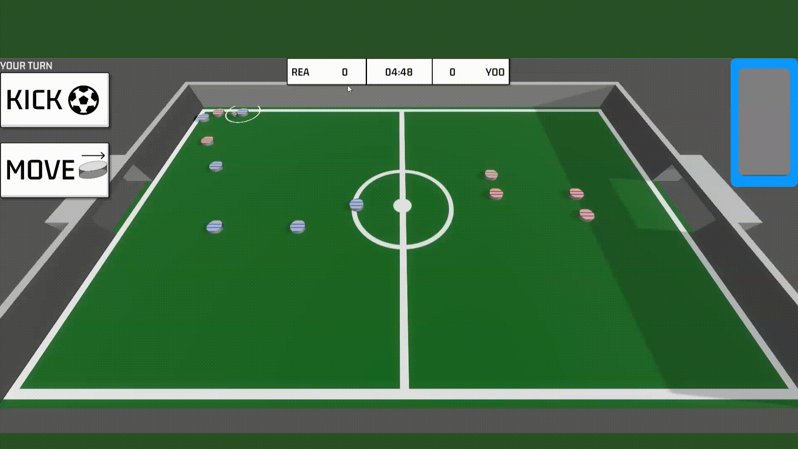
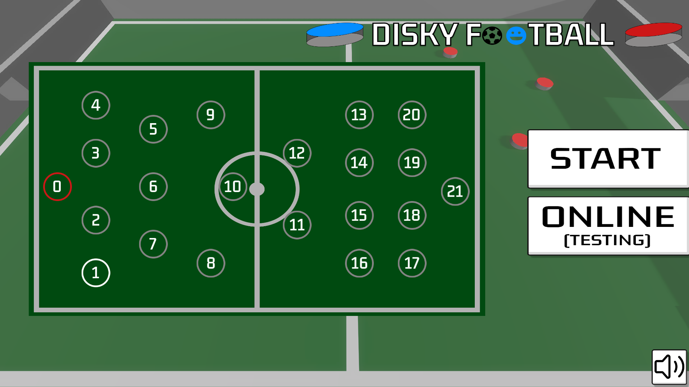
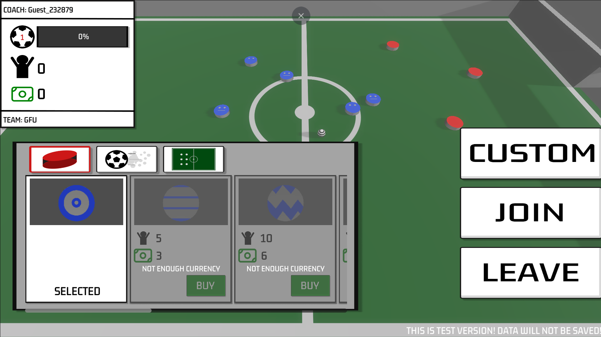
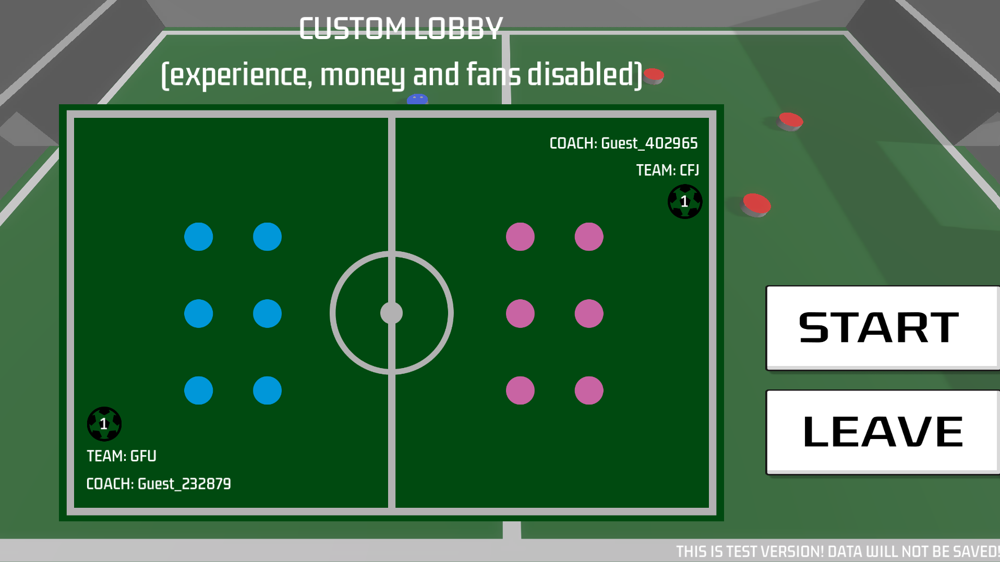

# Disky Football

> **3D online multiplayer football game with disks**

<a href="https://mexa123.itch.io/disky-football">
  
  Itch.io game page
</a>
 
<a href="https://youtu.be/eAnGfGoKED4">
  
  Youtube gameplay preview video
</a>

---

## Gameplay Preview

| Main Menu | Multiplayer Menu | Custom Lobby Menu |
| :---: | :---: | :--: |
|  |  | 

---

## Key game features
* Score 5 goals to win.
* Match duration 20 in-game minutes.
* 20 levels against BOT.
* Online multiplayer mode with custom lobby creation or random game join (implemented using Photon Fusion SDK for Godot Game Engine).
---

## Technical focus

* **Main project focus:** Implementing online multiplayer with Photon Fusion SDK in Godot Engine, using compact binary serialization instead of JSON to reduce network traffic overhead.
- **Encountered difficulties:** Since the Photon Fusion SDK for Godot is still under active development, automatic state synchronization didn't work reliably. To solve this, I implemented a turn-based synchronization model where the active player simulates the game state and transmits updated positions to the opponent.
